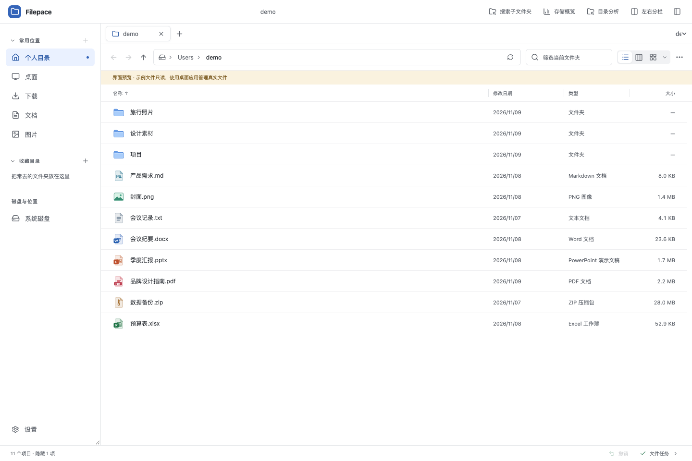
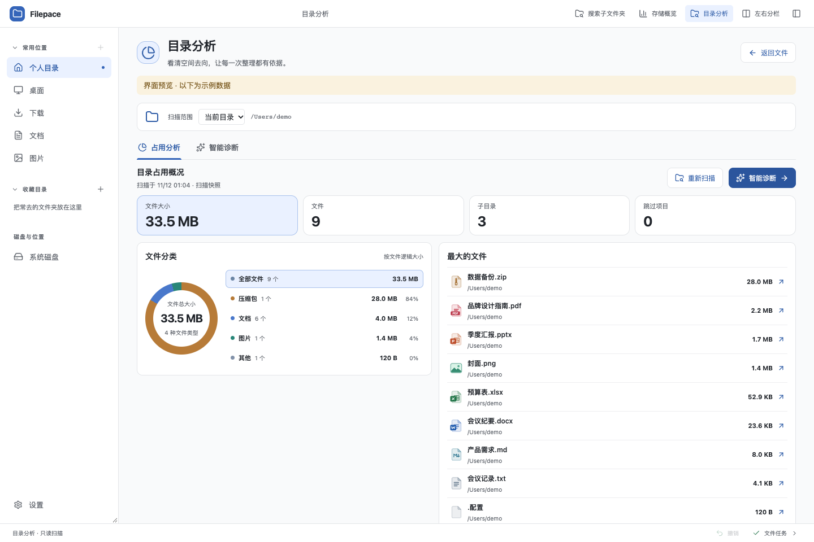

# Filepace

[简体中文](README.md)

Filepace is a local file manager for macOS and Windows. Open two folders side by side to drag files between them, or compare the folders before choosing what to copy. When you need to make room, Directory Analysis shows you the largest files and subfolders.

[Download and install](#download-and-install) · [Features](#features) · [Run from source](#run-from-source)



*The screenshot shows the read-only browser preview with sample files. Use the desktop app to work with your files.*

## Download and install

| Platform | v0.11.0 installer | How to install |
| --- | --- | --- |
| macOS (Apple Silicon) | [Download DMG][mac-download] | Open the disk image and drag Filepace to Applications. |
| Windows (x64) | [Download EXE][windows-download] | Run the installer to install for the current user. If WebView2 is missing, the installer downloads it. |

The macOS app is ad hoc signed and has no Apple notarization, so Gatekeeper may show a prompt on first launch. The Windows installer has no publisher signature and may show a SmartScreen prompt. [Release notes and SHA-256 checksums][release] · [Apple support][gatekeeper] · [Microsoft SmartScreen documentation][smartscreen]

If you already have v0.4.0 or later, check for updates under Settings → Update. For earlier versions, download the installer to upgrade.

## Features

### Browse and compare folders side by side

Open Split View (左右分栏) to give each folder its own tabs, selection, and navigation history. Switch any tab between List, Column, and Icon views. Drag frequently used folders to the sidebar to create shortcuts, or save your tabs and panes as a work layout.

In Work Layouts (工作布局), you can rename a saved layout or replace its tabs and panes with the current layout.

Dragging between directory columns, panes, or Filepace windows moves items by default. Hold **Option** on macOS or **Ctrl** on Windows when you drop to copy. Use Compare Folders (对比目录) to see what exists on only one side and what differs. Compare by size and modification time or by file contents, then select items to copy to the other pane.

### Find, preview, and organize files

| To do this | Start here |
| --- | --- |
| Find files in the current folder and its subfolders | Press **Command+F / Ctrl+F**. Filter by name, type, modification date, or minimum size and save searches you use often. |
| Preview a file | Select it and press **Space**. Filepace previews PDFs, Markdown, JSON, CSV/TSV, and code, among other formats. |
| Compress or extract files | Use the context menu to create a ZIP archive or browse a ZIP and choose where to extract it. |
| Rename several items at once | Select items in the same folder and press **F2**. Preview replacements, prefixes, suffixes, or numbering before applying the changes. |
| Check for duplicates | Press **Command+K / Ctrl+K** and choose Check Duplicate Files (检查重复文件). Filepace verifies matching candidates byte for byte on your machine. You choose which copy to keep and how to handle the others. |

The command palette recognizes common Chinese aliases and English keywords and explains why a command is unavailable.

Filepace uses Spotlight or Windows Search when available, with an option to scan all subfolders. Preview, rename, or move files directly from the search results.

Open File Tasks (文件任务) in the status bar to track copies and moves. If names conflict, choose whether to skip, replace, or keep both. A move across volumes writes the destination before removing the source. Deleted items and successfully replaced files go to the system Trash or Recycle Bin. Press **Command+Z / Ctrl+Z** to undo the last move or rename in the current session. [File operation verification and known limits](docs/scope.md#file-organization)

### See what takes up space

Storage Overview (存储概览) shows the capacity and free space of each volume. Open Directory Analysis (目录分析), or right-click a folder and choose Analyze This Directory (分析此目录), to see a breakdown by file type, a list of the largest files, and a treemap. Save a scan as a baseline before cleaning up, then scan the same folder again to see changes in file count and logical size.



Usage Analysis runs locally. The optional Smart Diagnosis (智能诊断) feature can use an installed and configured copy of **Codex, Claude Code, OpenCode, or DeepSeek Harness** to suggest ways to organize a folder or free up space. For diagnosis, Filepace supplies only file names, relative paths, scan statistics, your chosen goal, and any additional requirements. You decide which file changes to make and carry them out yourself. The selected tool may connect to its service, use your account allowance, and retain records according to its settings. [Tool configuration and platform verification](docs/scope.md#smart-storage-diagnosis)

## Run from source

Filepace uses Tauri, Rust, React, and TypeScript. Install Node.js 24 or later, stable Rust, and the build tools for your platform. [Tauri prerequisites][tauri]

From the repository root, run the following commands.

```sh
npm ci
npm run tauri dev
```

To browse the interface with sample files, run `npm run dev` for a read-only browser preview. Use the desktop app and a temporary folder to test real file operations.

### Test and package

```sh
npm test
npm run build
npm run test:e2e
cargo test --locked --manifest-path src-tauri/Cargo.toml
```

Local browser tests use Google Chrome. CI uses Playwright's Chromium.

```sh
# macOS
npm run tauri -- build --bundles app,dmg

# Windows
npm run tauri -- build --bundles nsis
```

Installers are written to `src-tauri/target/release/bundle/`. [Windows installation](docs/windows-installation.md) · [Release process](docs/releases.md)

## Contributing and license

Read the [contribution guide](CONTRIBUTING.md) and [repository instructions](AGENTS.md) before reporting an issue or submitting a change. Filepace is available under the [MIT License](LICENSE).

[release]: https://github.com/zhaoguhong/filepace/releases/tag/v0.11.0
[mac-download]: https://github.com/zhaoguhong/filepace/releases/download/v0.11.0/Filepace_0.11.0_aarch64.dmg
[windows-download]: https://github.com/zhaoguhong/filepace/releases/download/v0.11.0/Filepace_0.11.0_x64-setup.exe
[gatekeeper]: https://support.apple.com/en-us/102445
[smartscreen]: https://learn.microsoft.com/en-us/windows/apps/package-and-deploy/smartscreen-reputation
[tauri]: https://v2.tauri.app/start/prerequisites/
