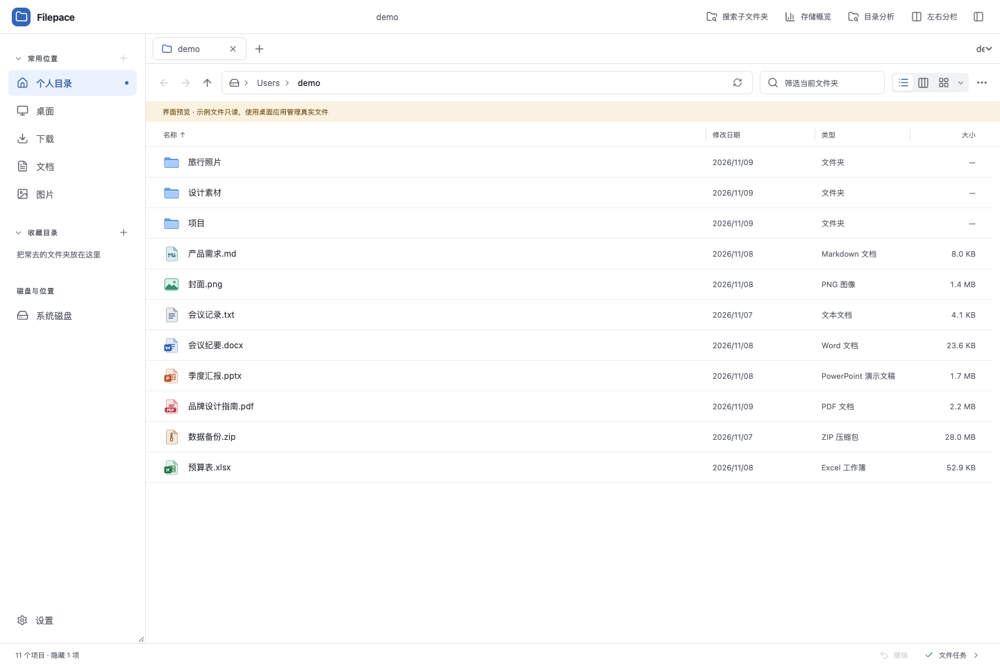
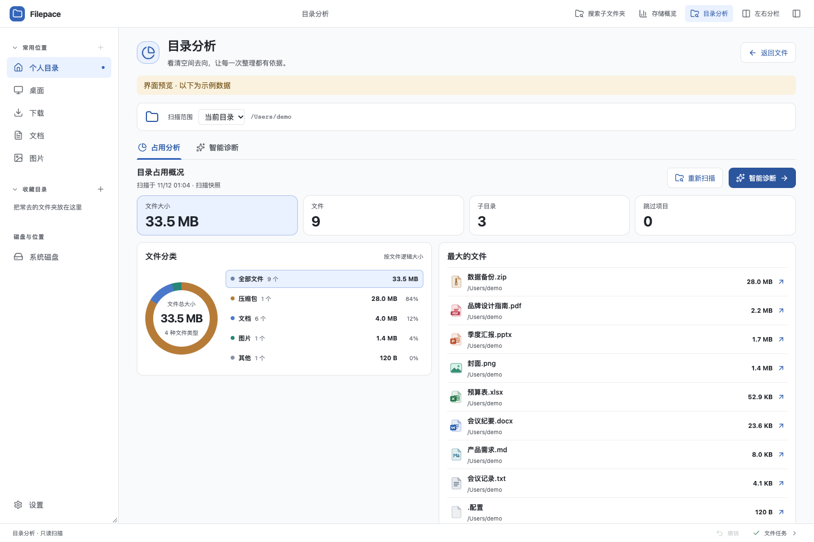

# Filepace

[简体中文](README.md)

Filepace is a local file manager for macOS and Windows. Organize files with tabs and split panes, inspect directory sizes, and get organizing suggestions from an AI tool you have already configured.

- **Browse and organize:** independent tabs, split panes, cross-window drag and drop, and List, Column, and Icon views.
- **Find and preview:** recursive search, directory comparison, PDF preview, and ZIP browsing.
- **Understand storage:** volume capacity, file categories, large files, and subfolder rankings.
- **Get optional AI advice:** Codex, Claude Code, OpenCode, and DeepSeek Harness, with your chosen direction and preservation requirements.



*Browser preview of the current source using sample directories. Real file operations require the desktop app; published releases may differ.*

[Download](#download-and-install) · [Directory analysis and AI](#storage-overview-and-directory-analysis) · [Run from source](#run-from-source)

## Download and install

Download the v0.9.0 installer for your system from the [GitHub Release](https://github.com/zhaoguhong/filepace/releases/tag/v0.9.0).

| System | Installer | How to install |
| --- | --- | --- |
| macOS (Apple Silicon) | [Download .dmg][mac-download] | Open the disk image and drag Filepace to Applications. |
| Windows (x64) | [Download .exe][windows-download] | Run the installer for the current user. If WebView2 is missing, the installer needs an internet connection to download it. |

The macOS app is ad-hoc signed and has no notarization, so Gatekeeper may show a prompt. Windows may show a SmartScreen warning because the installer has no publisher signature. [Apple support](https://support.apple.com/en-us/102445) · [Microsoft SmartScreen documentation](https://learn.microsoft.com/en-us/windows/apps/package-and-deploy/smartscreen-reputation)

## Work with two folders

- Press **Command+N** on macOS or **Ctrl+N** on Windows to open a separate window at the current location. Use the tab context menu to move a tab to a new window.
- **Split View (左右分栏)** opens a right pane in the current window. Each pane has its own tabs, selection, and navigation history. Sidebar navigation and keyboard shortcuts apply to the active pane.
- Drag a file or folder to another directory column, pane, or Filepace window to move it. Hold **Option** on macOS or **Ctrl** on Windows when you release the pointer to copy. Drop on a folder to put items inside it, or on blank space to use the directory displayed there.
- Hold a dragged file near the left or right edge of Column View to scroll to other columns.
- **Merge Panes (合并分栏)** returns to a single pane and keeps the tabs from both sides.
- A subtle highlight on the active pane's tab strip identifies where keyboard actions apply. Drag near the thin divider to resize, or double-click to restore equal widths. With the divider focused, use Left/Right to resize and Home to reset. Use the file context menu to copy or move the selection to the other pane. The shortcuts are **Command+Shift+C** or **Ctrl+Shift+C** to copy and **Command+Shift+M** or **Ctrl+Shift+M** to move.
- **Compare Folders (对比目录)** shows items that exist on one side or differ. Compare sizes and modification times or check file contents, then select items to copy to the other pane.

Right-click a file, folder, or blank space in the file list to copy its full path, show it in Finder or File Explorer, or open a command line. Filepace opens Terminal on macOS and PowerShell on Windows. When you right-click a file, the command line starts in its containing folder.

## Storage overview and directory analysis



Choose a directory, then switch between Usage Analysis and Smart Diagnosis. Scan actions belong to Usage Analysis. After scanning, Rescan becomes a secondary action beside the scan time, with Smart Diagnosis as the next primary action. You can also start diagnosis directly without a manual scan.

- Open **Storage Overview (存储概览)** in the window toolbar to see mounted volumes, their capacity, available space, and usage. Use a volume card to browse it or open its dedicated directory analysis page.
- Open **Directory Analysis (目录分析)** from the toolbar or a folder’s **Analyze This Directory (分析此目录)** context action. **Usage Analysis / Smart Diagnosis** share the selected directory and scan. Choose the current directory, a favorite, or a volume and start a scan. The report shows logical file sizes and counts by category, the largest files, and the largest subfolders. A donut chart shows category proportions. You can stop a scan or select a category to filter the largest files.
- Each window retains the eight most recent directory scan snapshots with their scan times. Switching scopes reuses the available snapshot. Diagnosis automatically rescans snapshots older than five minutes or marked changed. Snapshots describe a past scan and are not guaranteed to stay current.
- The directory treemap below the rankings represents logical file sizes by area. Drill into folders or select a file to preview and organize it in the linked list. Scans retain up to 8192 tree entries; gray areas aggregate omitted sizes. Rescan a subfolder for more detail.
- Save a scan baseline to compare logical size, file count and immediate subfolder changes after rescanning the same directory. Up to eight directory baselines persist across restarts and can be replaced or cleared. Skipped entries and incomplete detail are labeled, and missing records are not assumed deleted. Logical size changes do not measure reclaimed disk space.
- Click a result to locate it in Filepace or set a subfolder as the next scan scope. Scanning reads file metadata locally and skips links and inaccessible entries.
- Choose an installed **Codex, Claude Code, OpenCode, or DeepSeek Harness** CLI under **Smart Diagnosis (智能诊断)** and start diagnosis directly. Filepace collects directory metadata automatically before analysis when needed, reuses an existing scan of the selected scope, or rescans when requested. Filepace discovers commands automatically; expand the command-path setting to specify an executable and detect again. Install and sign in to the chosen tool from your terminal first.
- Choose Comprehensive, Free Up Space, Organize and Archive, Understand Folder, or Custom. Add optional requirements to any preset; Custom requires your own direction, up to 2,000 characters. Reports show the direction and requirements used. Understand Folder focuses on composition and space distribution without proactively suggesting file changes.
- Diagnosis supplies only names, relative paths, scan statistics, and your selected direction and requirements. It does not read file contents or change files automatically. The chosen tool may contact its model service, use your account allowance, and retain records according to its settings. Locate referenced files from the report, or stop either metadata preparation or AI analysis. Stopped, failed, and empty scans do not proceed to an agent. A diagnosis stays bound to its original directory and scan while you browse other directories or pages. Each window runs one diagnosis at a time and retains up to eight recent reports until the window closes. The sidebar keeps a progress/report entry, and completion or failure shows a notice with a return action. When Filepace is in the background, system notifications are available if allowed by your operating system. Closing its window stops the diagnosis. Browser previews cannot invoke local AI tools.

### Reuse your AI configuration

Filepace shows the detected executable, configured model, provider, and configuration source. Finding an executable does not verify authentication or connectivity; those are checked when diagnosis starts. The tool list places detected commands without configuration errors first, followed by commands needing configuration fixes and missing commands. Initial detection retains your saved tool when its executable and configuration are valid; otherwise, Filepace selects a detected tool without configuration errors and explains the change. Subsequent detections preserve your manual selection so you can fix its configuration or command path.

Usage Analysis works without any AI tools, including scan statistics, category charts, and locating large files. When no tools are detected, Smart Diagnosis explains this and provides a **View Usage Analysis (查看占用分析)** button.

| Tool | Configuration reuse |
| --- | --- |
| Codex | Loads model and connection settings from user configuration and named profiles; authentication stays with the original Codex home and sign-in. |
| Claude Code | Uses native safe mode while preserving user-level model and authentication settings. |
| OpenCode | Reads JSON / JSONC model and provider settings while retaining saved authentication. Built-in compatible adapters are supported; additional authentication plugins and provider packages may not work. |
| DeepSeek Harness | Invokes `dsh` using built-in model connections from the selected profile and home patch, saved credentials, and `.env`. The default source is `headless`; choose `web` or `desktop` if that is where your settings are saved. |

Project instructions, user plugins, and file-operation tools remain isolated. Filepace does not change your model configuration or store API keys in UI preferences; the original tools own authentication. Terminal-only arguments, aliases, and environment variables unavailable to the desktop process are not inherited. Configuration errors are shown without switching to another service. Dynamic expressions in Harness connection settings are currently unsupported.

A real Harness CLI on macOS passed a loopback model-service fixture covering configuration reuse and report parsing, without external model calls. Live Harness account authentication, installed OpenCode execution, and Windows desktop diagnosis remain unverified. [Verified scenarios and limits](docs/scope.md#smart-storage-diagnosis)

## Views and system actions

List, Column, and Icon views use colors and shapes to distinguish documents, media, archives, installers, design files, fonts, databases, and other types. Code and scripts have language badges for Python, Java, JavaScript, TypeScript, and other languages. Dockerfile, Makefile, `.gitignore`, and `.env` files are also recognized. macOS app bundles, Windows applications, and shortcuts such as `.lnk` and `.url` use their system icons when available. Shortcuts carry an arrow badge. **Display Options (显示选项)** beside the view switch contains sorting, grouping, hidden-file visibility, and four icon sizes. The drag preview shows the item icon, name, and selection count.

New tabs use List View by default. The toolbar orders the choices as List, Column, and Icon, and existing tabs keep their chosen views. In Column View, click a folder to open its contents in the next column, or select a file to see its preview or details. Drag a list header separator to resize columns; each tab remembers its widths. Double-click a separator to reset them. Hover over a long file name to see it in full; Icon View shows up to two lines.

Use the top address bar to view or enter a path, and its ellipsis to choose an ancestor folder. Filtering the current folder shows match counts, and folders containing only hidden items explain how to reveal them. The status bar shows item counts, selection sizes, file tasks, and the active pane in Split View. Folder creation, copy, cut, paste, and trash actions are available through context menus and keyboard shortcuts; empty folders also offer a creation action. Escape dismisses a menu, preview, or rename field while preserving the selection; press it again to clear the selection. Open folders refresh when local files change.

Large directories appear in batches, and leaving cancels further reads. Refresh keeps the previous list and selection until the complete result arrives. Individual filesystem calls on network or removable drives may still take time.

Drag from blank space in any view to draw a selection rectangle around files and folders. Hold **Shift** to select a range, or use **Command** on macOS and **Ctrl** on Windows to toggle individual items.

Click the sidebar's **Common Locations (常用位置)** or **Favorites (收藏目录)** heading to collapse or expand it. Use the plus button beside Common Locations to add the current folder. Right-click a shortcut to reorder or remove it. The sidebar remembers your changes.

Open **Settings (设置)** at the bottom of the sidebar to set the default view. Under **Appearance (外观)**, choose the display mode and theme separately. Display mode follows the system by default. The default theme uses a pure white background in light mode. Mist Blue, Warm Sand, Sage, Sea Salt Teal, Lilac, Rose, and Slate each support light and dark modes.

**Settings → About (关于)** shows the version, MIT license and GitHub project link, which opens in the default browser.

Use **Open With (打开方式)** to choose from the apps provided by the system. Use **Properties (属性)**, **Command+I** on macOS, or **Alt+Enter** on Windows to open the system info window for the selection. Filepace shows basic metadata if the system window is unavailable. Use **Copy Name (复制名称)** to copy selected names and the storage overview to open Disk Utility or Windows Storage Settings.

## App updates

Starting with v0.4.0, Filepace checks, downloads, and verifies stable updates from GitHub in the background. Use **Settings → Updates** to check manually or turn off automatic updates. Finish active file tasks before restarting to install an update. Upgrade from v0.3.0 or earlier by downloading the new installer once.

When a new version is found, a card above Settings at the bottom left shows its version and background download status. Once ready, the card offers access to the restart/update controls. With the sidebar hidden, the status bar retains the update entry. Check or download failures provide a retry entry in the same place.

## Search subfolders

Use **Search Subfolders (搜索子文件夹)**, **Command+F** on macOS, or **Ctrl+F** on Windows to look for file and folder names in the current directory and its subfolders. Choose a file type to narrow the search. Filepace queries Spotlight or Windows Search first and can scan the directory when the index is unavailable or incomplete. Click to select a result, double-click to open it, or use its trailing location button to reveal it.

Search results, usage rankings and AI report references share selection, previews, context menus and file tasks. Copy, cut, move, rename or trash files directly, or reveal them in the other pane. Pasting from a result page asks for an explicit destination; a folder's context menu can paste into that folder. Completed mutations update result locations and status while keeping the report. Usage totals remain a scan snapshot.

The current window retains six recent search scopes, including conditions, results, selection and scroll position. Use **Return to Search Results (返回搜索结果)** after revealing a file. Saved conditions can be named, updated, deleted and pinned to the sidebar.

Search by type, modification date, or minimum file size with or without a name. The path bar suggests recent folders, favorites, and matching subfolders.

## Commands, layouts and duplicate checks

Press **Command+K / Ctrl+K** to find actions and shortcuts in the command palette. Save or restore up to 12 named work layouts, including pane directories, tabs and views. **Settings → Browse** also offers compact list density.

**Check Duplicate Files (检查重复文件)** groups size candidates, hashes their contents with SHA-256 and confirms them byte for byte. Choose a retained file in each group before manually selecting other copies to organize. Detection is local, uses no AI and does not transmit file contents. It stays within one filesystem, skips links, excludes hard-link aliases and labels partial results at its scan/read/display limits. Changed groups require another check before destructive actions.

## File operations

Open **File Tasks (文件任务)** in the status bar to see progress and results. When names conflict, compare the source and destination paths, file sizes, and modification times before choosing to skip, replace, or keep both. Moves on the same volume rename the original when the destination is vacant. Moves across volumes commit the staged destination before removing the source. Deletions and successfully replaced items go to the system trash. If a task is running when you close the last window, Filepace asks whether to continue it or cancel it and close the window. View recent local errors under **Settings → Error Log (错误日志)**.

Tasks show their sources and destination, scanned totals where available, transferred bytes and measured rate/ETA when meaningful. Unknown or invalid totals stay explicit; same-volume moves retain their fast rename behavior. Space previews also render Markdown, format JSON, display CSV/TSV tables and highlight code, with a source-text option.

Copy, move and trash tasks support pause, resume and cancel. Pausing takes effect at a safe checkpoint and lets other waiting tasks run; native calls and commit steps can delay acknowledgement. Paused tasks resume independently, showing a waiting state while another task executes. Move waiting tasks up or down in the displayed execution order. Archive and batch-rename tasks can pause before starting. Pauses last for the current session; restart recovery continues to show review notices.

- After an interrupted staged transfer or replacement, the next launch shows review notices in File Tasks with the last recorded phase and source, target, stage, and old-target backup paths. It does not resume or delete files automatically. Clearing task history acknowledges the notice and removes only its recovery journal. Undo remains limited to the current session.
- Windows copies use the native API to preserve alternate data streams and file attributes. Destination permissions follow Windows inheritance. A target that fails to preserve sparse attributes is rejected before removing the source.
- Use **Undo (撤销)** in the status bar or press **Command+Z** / **Ctrl+Z** to undo the most recent move or rename in the current session. Filepace stops if the original location is occupied or the item has been replaced. Replaced items can be recovered through the system trash.
- Select multiple items and press **F2** to preview a batch rename. Find and replace text, add a prefix or suffix, or number the items. Undo can reverse the batch.
- Press **Space** on a PDF to preview it and switch pages. Use **Browse Archive (浏览压缩包)** in a ZIP file's context menu to inspect entries and choose where to extract. Extraction validates entry paths and prepares the contents in a temporary folder before committing the result.
- Use **Compress to ZIP (压缩为 ZIP)** in the context menu to archive selected items with the system tool where available.

Filepace saves tabs and pane locations for each window and uses the signed-in user's filesystem permissions. You can browse symbolic links. File transfers involving symbolic links are currently unsupported. [Platform verification and known gaps](docs/scope.md)

## Run from source

Built with Tauri, Rust, React, and TypeScript.

Install Node.js 24 or later, stable Rust, and the build tools for your operating system. [Tauri platform prerequisites](https://v2.tauri.app/start/prerequisites/)

```sh
npm ci
npm run tauri dev
```

`npm run dev` opens a read-only browser preview with sample files. Use the desktop app to test real file operations on disposable folders.

## Test and build

```sh
npm test
npm run build
npm run test:e2e
cargo test --locked --manifest-path src-tauri/Cargo.toml
```

The browser tests use a local Google Chrome installation. In CI, the workflow installs Playwright's Chromium.

```sh
# macOS
npm run tauri -- build --bundles app,dmg

# Windows
npm run tauri -- build --bundles nsis
```

Bundles appear under `src-tauri/target/release/bundle/`. GitHub Actions checks both platforms. Use the manual workflow to upload installer artifacts. [Windows installation](docs/windows-installation.md) · [Release checks](docs/releases.md)

## Contributing and license

See [CONTRIBUTING.md](CONTRIBUTING.md) and [AGENTS.md](AGENTS.md) for repository guidelines. Filepace is available under the [MIT License](LICENSE). Dependencies retain their own licenses.

[mac-download]: https://github.com/zhaoguhong/filepace/releases/download/v0.9.0/Filepace_0.9.0_aarch64.dmg
[windows-download]: https://github.com/zhaoguhong/filepace/releases/download/v0.9.0/Filepace_0.9.0_x64-setup.exe
