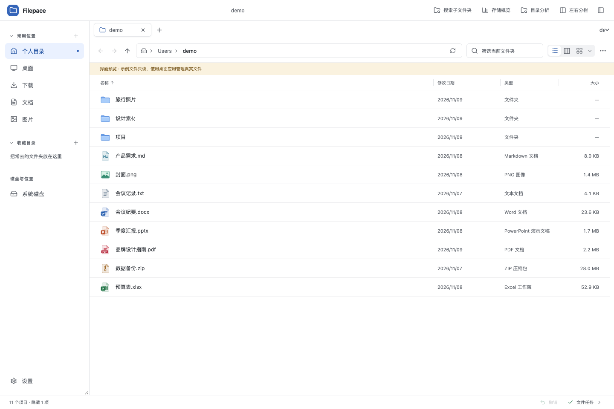

# Filepace

[English](README.en.md)

Filepace 是一款适用于 macOS 和 Windows 的本地文件管理器。你可以并排打开两个目录，在两栏之间拖放文件，或对比后把有差异的文件复制过去。需要腾空间时，打开「目录分析」，就能看到最大的文件和最占空间的子目录。

[下载安装](#下载安装) · [主要功能](#主要功能) · [从源码运行](#从源码运行)



*截图来自使用示例文件的只读浏览器预览。实际文件操作请使用桌面应用。*

## 下载安装

| 平台 | v0.11.0 安装包 | 安装方式 |
| --- | --- | --- |
| macOS（Apple 芯片） | [下载 DMG][mac-download] | 打开磁盘映像，将 Filepace 拖到「应用程序」。 |
| Windows（x64） | [下载 EXE][windows-download] | 双击安装包，为当前用户安装。缺少 WebView2 时，安装程序会联网下载。 |

macOS 版采用临时签名，尚未通过 Apple 公证，首次打开时可能出现 Gatekeeper 提示。Windows 安装包没有发布者签名，可能出现 SmartScreen 提示。[发布说明与 SHA-256 校验值][release] · [Apple 支持][gatekeeper] · [Microsoft SmartScreen 文档][smartscreen]

已安装 v0.4.0 或更新版本时，可以在「设置 → 更新」里检查更新。更早的版本请下载安装包升级。

## 主要功能

### 并排浏览和对比目录

点击「左右分栏」，两边各自保留标签页、选区和浏览历史。每个标签页可切换列表、列视图或图标视图。常用文件夹可以拖到侧栏创建快捷入口，也可以把整套标签页和分栏保存为工作布局。

在「工作布局」里可单独给已保存的布局改名。要用当前布局覆盖它的标签页和分栏，勾选「同时更新为当前标签页与分栏」后保存。

在目录列、分栏或 Filepace 窗口之间拖放时，默认移动。松开鼠标时按住 macOS 的 **Option** 或 Windows 的 **Ctrl** 即可复制。点击「对比目录」，可以查看哪些项目只在一侧存在，哪些项目有差异。默认比较大小和修改时间，也可比较文件内容。勾选项目后可复制到另一侧。

### 查找、预览和整理文件

| 想做什么 | 从哪里开始 |
| --- | --- |
| 在当前文件夹和子文件夹里找文件 | 按 **⌘F / Ctrl+F**。可按名称、类型、修改日期或最小大小筛选，也可保存常用条件。 |
| 快速查看文件内容 | 选中文件后按 **空格**。支持 PDF、Markdown、JSON、CSV/TSV 和代码等格式。 |
| 打包或解压文件 | 从右键菜单压缩为 ZIP，或浏览 ZIP 包内的文件并选择解压位置。 |
| 批量改名 | 选中同一目录内的多个项目，按 **F2** 预览查找替换、前后缀或编号的结果，再应用。 |
| 检查重复文件 | 按 **⌘K / Ctrl+K** 打开命令面板，选择「检查重复文件」。Filepace 在本机逐字节核对候选文件，由你决定保留哪一份、如何处理副本。 |

命令面板支持「去重」「双栏」等常用说法和英文关键词，并会说明操作不可用的原因。

搜索优先使用 Spotlight 或 Windows Search，也可扫描全部子目录。搜索结果可以直接预览、改名或移动。

状态栏的「文件任务」显示复制、移动等操作的进度。遇到同名项目时，可以选择跳过、替换或保留两者。跨卷移动会先完成目标写入，再移除源项目。删除的项目和被替换的旧项目会进入系统废纸篓或回收站。用 **⌘Z / Ctrl+Z** 可以撤销本次会话中最近一次移动或改名。[文件操作的验证与已知限制](docs/scope.md#file-organization)

### 找出最占空间的文件

「存储概览」显示各磁盘的容量和剩余空间。打开「目录分析」，或右键文件夹选择「分析此目录」，即可查看文件分类、大文件排行和目录矩形树图。清理前保存一次扫描作为基线，清理后重新扫描，就能看到文件数量和逻辑大小的变化。


占用分析在本机运行。「智能诊断」是可选功能，可以调用你已安装并配置的 **Codex、Claude Code、OpenCode 或 DeepSeek Harness**，按你选择的方向提出整理或清理建议。Filepace 只向所选工具提供文件名、相对路径、扫描统计、诊断方向和补充要求。文件改动由你决定并操作。所选工具可能联网、使用你的账号额度，并按其设置保留记录。[工具配置及平台验证](docs/scope.md#smart-storage-diagnosis)

## 从源码运行

项目使用 Tauri、Rust、React 和 TypeScript。准备 Node.js 24 或更高版本、稳定版 Rust 和对应平台的构建工具。[Tauri 环境要求][tauri]

在仓库根目录安装依赖并启动桌面应用。

```sh
npm ci
npm run tauri dev
```

只想查看界面时，运行 `npm run dev` 打开使用示例文件的只读浏览器预览。验证真实文件操作时，请在桌面应用里使用临时目录。

### 测试与打包

```sh
npm test
npm run build
npm run test:e2e
cargo test --locked --manifest-path src-tauri/Cargo.toml
```

本地浏览器测试使用 Google Chrome，CI 使用 Playwright 的 Chromium。

```sh
# macOS
npm run tauri -- build --bundles app,dmg

# Windows
npm run tauri -- build --bundles nsis
```

安装包位于 `src-tauri/target/release/bundle/`。[Windows 安装说明](docs/windows-installation.md) · [发布流程](docs/releases.md)

## 贡献与许可证

提交问题或代码前，请阅读[贡献指南](CONTRIBUTING.md)和[仓库约定](AGENTS.md)。Filepace 采用 [MIT 许可证](LICENSE)。

[release]: https://github.com/zhaoguhong/filepace/releases/tag/v0.11.0
[mac-download]: https://github.com/zhaoguhong/filepace/releases/download/v0.11.0/Filepace_0.11.0_aarch64.dmg
[windows-download]: https://github.com/zhaoguhong/filepace/releases/download/v0.11.0/Filepace_0.11.0_x64-setup.exe
[gatekeeper]: https://support.apple.com/zh-cn/102445
[smartscreen]: https://learn.microsoft.com/en-us/windows/apps/package-and-deploy/smartscreen-reputation
[tauri]: https://v2.tauri.app/start/prerequisites/
