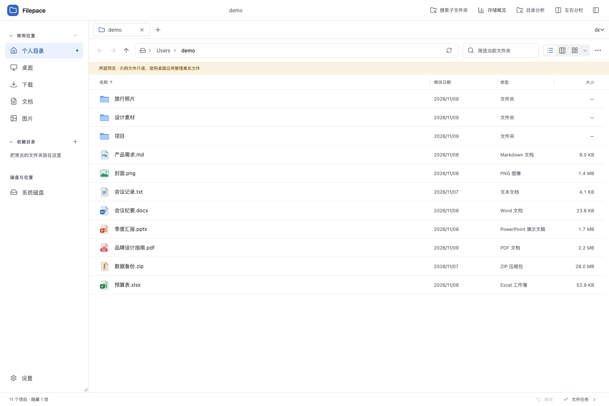
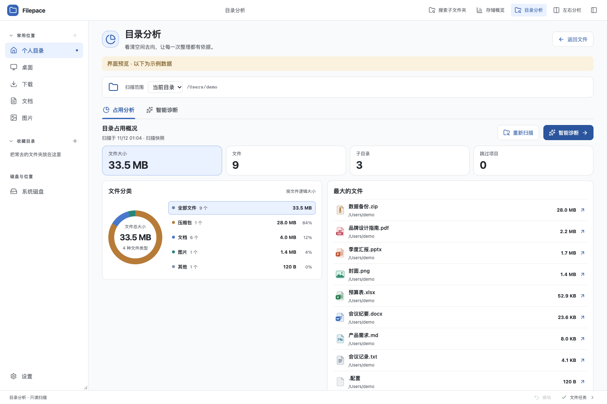

# Filepace

[English](README.en.md)

Filepace 是一款适用于 macOS 和 Windows 的本地文件管理器。用标签页和左右分栏整理文件，查看目录的空间占用，也可以调用已经配置好的 AI 工具获取整理建议。

- **浏览与整理**：独立标签页、左右分栏、多窗口拖放，以及列表、列和图标视图。
- **查找与预览**：跨目录搜索、目录对比、PDF 预览和 ZIP 浏览。
- **了解空间占用**：查看磁盘容量、文件分类、大文件和子目录排行。
- **按需获取 AI 建议**：支持 Codex、Claude Code、OpenCode 和 DeepSeek Harness；由你选择分析方向和要保留的内容。



*当前源码的浏览器预览，使用示例目录。真实文件操作需要桌面应用；发布版功能以对应版本说明为准。*

[下载安装](#下载安装) · [目录分析与 AI](#存储概览与目录分析) · [从源码运行](#从源码运行)

## 下载安装

在 [GitHub Release](https://github.com/zhaoguhong/filepace/releases/tag/v0.9.0) 下载适合你的 v0.9.0 安装包。

| 系统 | 安装包 | 安装方式 |
| --- | --- | --- |
| macOS（Apple 芯片） | [下载 .dmg][mac-download] | 打开磁盘映像，将 Filepace 拖到「应用程序」。 |
| Windows（x64） | [下载 .exe][windows-download] | 运行安装程序，为当前用户安装。如果系统缺少 WebView2，安装程序需要联网下载。 |

macOS 版使用临时签名，尚未公证，首次打开可能出现「门禁」提示。Windows 版尚未签名，运行时可能出现 SmartScreen 提示。[Apple 支持](https://support.apple.com/zh-cn/102445) · [Microsoft SmartScreen 文档](https://learn.microsoft.com/en-us/windows/apps/package-and-deploy/smartscreen-reputation)

## 同时整理两个目录

- 按 macOS 的 **⌘N** 或 Windows 的 **Ctrl+N**，在当前位置打开独立窗口。也可通过标签页右键菜单将标签移到新窗口。
- 点「左右分栏」会在当前窗口内打开右侧窗格。两侧各有独立的标签页、选区和浏览历史。侧栏导航和键盘快捷键作用于当前窗格。
- 把文件或文件夹拖到另一列、另一侧窗格或另一个 Filepace 窗口，默认移动。松开鼠标时按住 macOS 的 **Option** 或 Windows 的 **Ctrl** 就会复制。拖到文件夹上会放入该文件夹，拖到空白处会放入该处显示的目录。
- 拖动文件时，把鼠标停在列视图的左侧或右侧边缘，列表会横向滚动，露出其他列。
- 点「合并分栏」会回到单栏，并保留两边的标签页。
- 当前操作栏的标签区域有轻微高亮，中间使用细分隔线；将鼠标移到线附近即可拖动调宽，双击恢复等宽。分隔线获得键盘焦点后，可用左右方向键调整，Home 恢复等宽。可用文件右键菜单把选区复制或移动到另一栏，也可按 **⌘⇧C** / **Ctrl+Shift+C** 复制、**⌘⇧M** / **Ctrl+Shift+M** 移动。
- 点「对比目录」查看两栏中仅一侧存在或有差异的项目。默认比较大小与修改时间，也可比较文件内容，勾选结果后复制到另一栏。

右键单击文件、文件夹或文件列表的空白处，可以复制完整路径、在 Finder 或资源管理器中显示，或打开命令行。macOS 使用终端，Windows 使用 PowerShell。右键单击文件时，命令行会在文件所在目录启动。

## 存储概览与目录分析



先选目录，再切换「占用分析 / 智能诊断」。扫描操作放在占用分析内；有结果后，「重新扫描」位于扫描时间旁，主要入口转为「智能诊断」。可以直接进入诊断，不必先手动扫描。

- 点击窗口顶部的「存储概览」查看已挂载卷的容量、可用空间和使用比例。可以从卷卡片浏览磁盘，或点击「分析此磁盘」进入独立的目录分析页面。
- 从窗口顶部进入「目录分析」，或右键文件夹选择「分析此目录」。页面共用一个扫描范围，通过「占用分析 / 智能诊断」页签切换。选择当前目录、常用位置或一个卷，点击「开始扫描」。扫描统计文件逻辑大小与数量，列出文件分类、最大的文件和占用最多的子目录。占用分析用环形图展示分类比例，点击分类可筛选大文件列表；扫描中可停止。
- 当前窗口保留最近 8 个目录的扫描快照，切回范围可复用，并显示扫描时间。快照超过 5 分钟或检测到目录变化时会提示；开始智能诊断前会自动重新扫描。快照反映扫描时的状态，无法保证实时更新。
- 占用分析下方的「目录矩形树图」按面积显示文件逻辑大小。点击目录逐层展开，点击文件后可在联动列表中预览和整理。扫描最多保留 8192 项图形明细，未展开大小合并为灰色区域；可选子目录重新扫描。
- 在「扫描前后对比」保存当前扫描为基线，重新扫描同一目录后查看文件大小、数量和直接子目录的变化。最多保留 8 个目录的基线，重启后仍可使用，也可替换或清除。跳过项目或明细不完整时会提示，缺失记录不会被直接判定为已删除；逻辑大小差值不等于实际释放空间。
- 点击结果可回到文件所在目录，也可以把一个子目录设为下一次扫描的范围。扫描在本机读取文件元数据，跳过链接和无法访问的项目。
- 在「智能诊断」选择本机的 **Codex、Claude Code、OpenCode 或 DeepSeek Harness**，点击「开始诊断」即可。没有目录信息时会自动扫描，完成后继续分析；已有当前范围的扫描结果会直接复用，也可勾选「重新扫描后诊断」。Filepace 自动查找命令，也可展开「指定命令路径」填写可执行文件的完整路径，再重新检测。请先在终端安装并登录相应工具。
- 诊断方向提供「综合诊断」「清理空间」「整理归档」「了解目录」和「自定义」。可以为预设方向补充要求，例如保留照片和源码；选择「自定义」时需填写自己的分析方向，最多 2000 字。报告会标明本次方向与要求。「了解目录」侧重介绍构成与空间分布，不主动提出文件变更建议。
- 智能诊断仅向所选工具提供目录扫描的文件名、相对路径、统计，以及所选方向和补充要求，不读取文件内容，也不自动修改文件。工具可能联网、使用已有账号额度并按其设置保留记录。报告中的相关文件可直接定位；准备目录信息和 AI 分析两个阶段都可停止，停止、失败或空目录不会继续发起 AI 分析。诊断固定使用启动时的目录和扫描快照，切换目录或页面后仍会继续。每个窗口同时运行一项诊断，并在窗口关闭前保留最近 8 个目录的报告。侧栏提供进度和报告入口，完成或失败后显示可返回查看的提示；应用在后台时，可通过系统允许的通知提醒。关闭所属窗口会停止诊断。浏览器预览不能调用本机 AI 工具。

### 使用已经配置好的 AI 工具

Filepace 显示找到的程序、配置模型、服务商和配置来源。「已找到程序」仅代表命令存在，登录和服务连接会在开始诊断时验证。工具列表优先显示已找到且配置无报错的工具，配置待处理和未找到的工具排在后面。首次检测时优先保留上次选择；如果该工具未安装或配置有报错，会选择一个已找到且配置无报错的工具并提示。之后重新检测会保留你的手动选择，方便修复配置或指定命令路径。

没有安装任何 AI 工具也能正常使用占用分析，包括扫描统计、分类图表和大文件定位。智能诊断会显示未检测到工具的提示，并提供「查看占用分析」入口。

| 工具 | 如何复用配置 |
| --- | --- |
| Codex | 读取用户配置中的模型和服务连接，支持默认配置及已有命名方案；认证继续使用原来的 Codex 登录状态。 |
| Claude Code | 使用原工具的安全模式，保留用户级模型和认证配置。 |
| OpenCode | 读取 JSON / JSONC 中的模型、服务商和连接设置，沿用原工具保存的认证数据。支持内置兼容适配器；依赖额外认证插件或 provider 包的配置可能不可用。 |
| DeepSeek Harness | 调用 `dsh`，复用所选方案与全局补丁中的内置模型连接、凭据和 `.env`。默认读取 `headless`；如果配置保存在 `web` 或 `desktop`，可在「配置方案」中选择。 |

诊断继续隔离项目指令、用户插件和文件操作工具。Filepace 不修改原来的模型配置，也不把密钥存入界面偏好；认证由原工具管理。终端临时参数、别名和未传给桌面进程的环境变量不会自动继承。配置错误会明确提示，Filepace 不会因此改用另一家服务。Harness 连接配置中的动态表达式暂不支持。

macOS 上已使用真实 Harness CLI 和本机模拟模型服务验证配置复用及报告解析，没有调用外部模型。其真实账号认证、OpenCode 实机调用以及 Windows 桌面诊断仍需验证。[已验证场景与限制](docs/scope.md#smart-storage-diagnosis)

## 查看与系统操作

列表、列视图和图标视图用颜色和图形区分文档、影音、压缩包、安装包、设计文件、字体、数据库等类型。Python、Java、JavaScript、TypeScript 等代码和脚本显示各自的语言标识，也能识别 Dockerfile、Makefile、`.gitignore` 和 `.env` 等文件。macOS 应用包、Windows 应用及 `.lnk`、`.url` 等快捷方式优先读取系统图标，快捷方式带有箭头标记。视图切换旁的「显示选项」提供排序、分组、隐藏文件和小、中、大、超大四种图标尺寸。拖动时会显示文件图标、名称和多选数量。

新标签默认使用列表视图，工具栏按列表、列视图、图标的顺序排列。已有标签保留各自的视图。在列视图中，单击文件夹会在右侧展开下一列，选中文件会显示预览或基本信息。拖动列表表头的分隔线可调整列宽，每个标签分别记忆，双击分隔线恢复默认。长文件名可悬停查看完整名称，图标视图最多显示两行。

顶部地址栏用于查看路径和前往文件夹，上级目录可从省略号选择。当前目录筛选会显示匹配数量，文件夹只有隐藏项目时会说明原因并提供显示入口。底栏显示项目数、选区大小和文件任务，分栏时标明当前操作的窗格。新建文件夹、复制、剪切、粘贴和删除可从右键菜单或快捷键操作，空目录也提供新建入口。按 Esc 关闭菜单、预览或改名时会保留选区，再按一次可取消选择。打开的目录会随本机文件变化刷新。大目录会分批显示已读取的项目，离开后取消后续读取；刷新时保留原列表和选区，完整结果到达后再更新。网络或可移动磁盘上的单次系统调用仍可能需要等待。

在三种视图中，都可以从空白处按住鼠标拖出选框，一次选中文件和文件夹。也可以按住 **Shift** 选取连续项目，或按住 macOS 的 **⌘**、Windows 的 **Ctrl** 逐个增减选区。

点击侧栏的「常用位置」或「收藏目录」标题可折叠和展开。点击「常用位置」旁的加号可加入当前文件夹，右键快捷入口可调整顺序或移除。侧栏会记住这些设置。

从侧栏底部打开「设置」，在「浏览」中可选择新标签的默认视图。在「外观」中可以分别选择显示模式和主题。显示模式默认跟随系统，默认主题在浅色模式下使用纯白背景。雾蓝、暖砂、松雾绿、海盐青、暮藤紫、蔷薇粉和石板灰也各有浅色和深色版本。

「设置 → 关于」显示应用版本、MIT 许可证和 GitHub 项目地址，可在默认浏览器打开源码仓库。

右键「打开方式」可选用系统提供的应用。右键「属性」或按 macOS 的 **⌘I**、Windows 的 **Alt+Enter**，可查看选中项目的系统简介或属性。系统窗口无法打开时会显示基本信息。「复制名称」可复制所选项目的名称，存储概览可直达 macOS 磁盘工具或 Windows 存储设置。

## 应用更新

从 v0.4.0 起，Filepace 会后台检查、下载并校验 GitHub 上的正式更新。在「设置 → 更新」可以手动检查，或关闭自动更新。选择「重启更新」前请完成正在运行的文件任务。v0.3.0 和更早版本可从发布页下载安装包升级一次。

发现新版本后，左下角「设置」上方的卡片会显示版本号和后台下载状态；下载完成后显示「可重启更新」。隐藏侧栏时，底部状态栏仍保留更新入口。检查或下载失败时，可从同一入口查看并重试。

## 跨目录搜索

点窗口顶部的「搜索子文件夹」，或按 macOS 的 **⌘F**、Windows 的 **Ctrl+F**，在当前文件夹和子文件夹里按名称和类型查找。Filepace 优先查询 Spotlight 或 Windows Search。索引不可用时会扫描目录，也可从索引结果切换到「扫描全部子目录」。单击结果选择文件，双击打开，点行末的定位按钮打开所在目录。

可单独按类型、修改日期或最小文件大小搜索。保存的条件可以命名、更新、删除或固定到侧栏。当前窗口保留最近六个搜索范围的条件、结果、选区和滚动位置，定位后可点「返回搜索结果」继续整理。输入路径时会显示最近目录、收藏和匹配的子目录。

搜索结果、占用排行和 AI 报告的相关文件都支持多选、空格预览、右键复制、剪切、移动、改名和移到回收站，也可在另一栏定位。粘贴到结果页时会要求确认目标文件夹；右键文件夹可直接粘贴到其中。操作沿用普通文件任务，完成后保留结果现场，并标明已移动、改名或删除的条目。占用统计仍是扫描快照，目录有变化后需重新扫描。

## 常用操作与重复检查

按 **⌘K / Ctrl+K** 打开命令面板，输入操作名称查找入口和快捷键。可以从这里检查重复文件、保存或恢复工作布局；「设置 → 浏览」提供紧凑列表密度。工作布局保留左右目录、标签页和视图，最多保存 12 个。

「检查重复文件」在本机读取候选内容，按大小筛选后计算 SHA-256，并逐字节核对。每组先手动选择保留文件，再选中其他副本整理，不会自动删除。检查仅覆盖当前文件系统，跳过链接，硬链接别名不算独立副本；达到读取或展示上限时会注明部分结果。文件变化后需重新检查。此检查不调用 AI，也不向外部发送文件内容。

## 文件操作

点击状态栏的「文件任务」查看进度和处理结果。遇到同名项目时，可以对照源和目标的完整路径、文件大小和修改时间，再选择跳过、替换或保留两者。同卷且目标空闲时直接移动原项目。跨卷移动会先暂存并提交目标，再移除源文件。删除的文件和替换成功后的旧目标会进入系统废纸篓或回收站。关闭最后一个窗口时，如果还有文件任务在运行，Filepace 会询问是继续任务，还是取消任务并关闭窗口。可在「设置 → 错误日志」查看最近的本机错误。

任务面板展示源与目标。复制在可用时显示扫描总量、已传输字节、测得速度和剩余时间估计；总量未知或失效时会明确说明。同卷移动继续使用快速改名，不为估算进度额外遍历整个目录。空格预览还支持 Markdown 排版、JSON 格式化、CSV/TSV 表格和代码着色，可切换原文。

复制、移动和移到回收站任务可暂停、继续或取消。点击暂停后，任务会在安全步骤暂停，再执行其他等待任务；系统调用和提交阶段可能需要等待。多项已暂停任务可分别继续，其他任务正在执行时会显示「等待继续」。等待队列显示实际顺序，可用上移、下移调整；压缩、解压和批量改名可在等待时暂停。暂停仅限当前会话，应用重启后仍按中断恢复提示处理。

- 暂存传输或替换意外中断后，下次启动会在「文件任务」显示最后记录的阶段，以及源、目标、暂存和旧目标备份位置，供你核对；不会自动续传或删除这些文件。清理任务记录只会确认并移除恢复提示。撤销记录仍仅限本次会话。
- Windows 文件复制使用系统接口保留备用数据流与文件属性，目标权限遵循系统继承规则；目标不支持保留稀疏属性时会报错并保留源文件。
- 从状态栏的「撤销」或按 **⌘Z** / **Ctrl+Z**，撤销本次会话最近一次移动或改名。原位置被占用或文件已被替换时会停下来。被替换的旧项目可从系统废纸篓或回收站恢复。
- 选中多个项目按 **F2** 打开批量重命名。支持查找替换、前后缀和编号，预览通过后可应用，也可整批撤销。
- 选中 PDF 按空格可预览和翻页。右键 ZIP 选「浏览压缩包」可查看成员和指定解压位置。解压会检查包内路径，验证完成后才提交目标文件夹。
- 右键「压缩为 ZIP」会把选中的项目归档到当前目录，优先使用系统工具。

Filepace 保存各窗口的标签页和分栏打开的目录，并使用当前用户的文件系统权限。可以浏览符号链接，文件传输暂不支持符号链接。[平台验证和已知限制](docs/scope.md)

## 从源码运行

项目使用 Tauri、Rust、React 和 TypeScript。

安装 Node.js 24 或更高版本、稳定版 Rust，以及对应系统的构建工具。[Tauri 环境要求](https://v2.tauri.app/start/prerequisites/)

```sh
npm ci
npm run tauri dev
```

`npm run dev` 启动的是使用示例文件的只读浏览器预览。验证真实文件操作时，请在桌面应用中使用临时目录。

## 测试与打包

```sh
npm test
npm run build
npm run test:e2e
cargo test --locked --manifest-path src-tauri/Cargo.toml
```

本地浏览器测试使用 Google Chrome。CI 使用 Playwright 安装的 Chromium。

```sh
# macOS
npm run tauri -- build --bundles app,dmg

# Windows
npm run tauri -- build --bundles nsis
```

安装包生成在 `src-tauri/target/release/bundle/` 下。GitHub Actions 会在两个平台运行检查，手动运行工作流时可以上传安装包产物。[Windows 安装说明](docs/windows-installation.md) · [发布检查](docs/releases.md)

## 贡献与许可证

提交问题或代码前请阅读 [CONTRIBUTING.md](CONTRIBUTING.md) 和 [AGENTS.md](AGENTS.md)。Filepace 采用 [MIT 许可证](LICENSE)，依赖使用各自的许可证。

[mac-download]: https://github.com/zhaoguhong/filepace/releases/download/v0.9.0/Filepace_0.9.0_aarch64.dmg
[windows-download]: https://github.com/zhaoguhong/filepace/releases/download/v0.9.0/Filepace_0.9.0_x64-setup.exe
